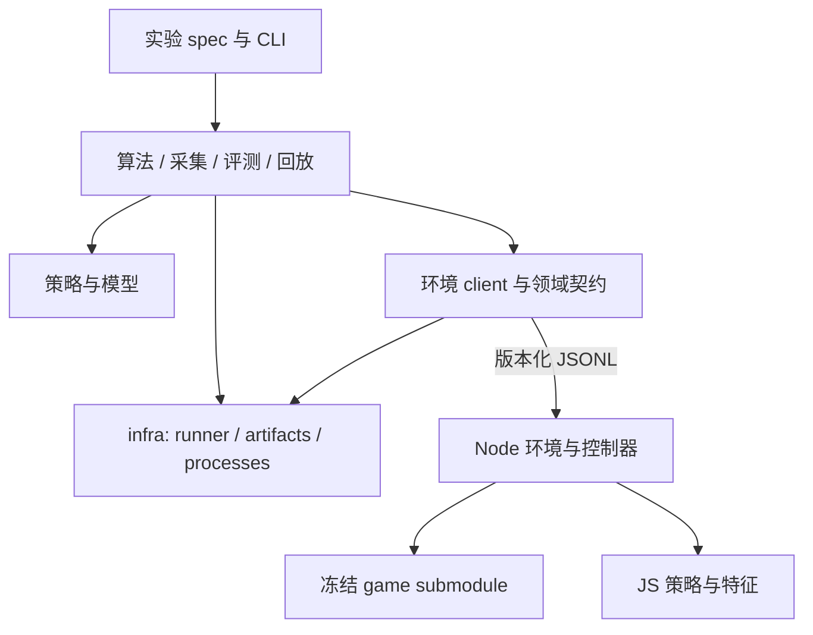

# 架构重设计建议

状态：设计提案，2026-10-18；基于 c434cdc 的源码检查。尚未实施下述抽取，训练仍暂停。

## 判断

上次迁移完成了目录归类、原始数据保全和 game 冻结，但保留了原实现及其依赖关系。现在的主要问题是职责和依赖，继续搬目录不足以解决。

本次扫描 adapters、strategies、studies、evaluation、replay、scripts 下的 Python/JS/MJS，共 248 个文件、30,813 行；其中历史启动器 63 个、4,157 行。统计包含测试，不包含 game、第三方依赖、结果、网页 overlay 和文档。文件数量只用于定位问题，不作为重构验收指标。

## 当前证据

| 事实 | 源码位置 | 影响 |
|---|---|---|
| 一个 learner 同时定义环境进程、网络、checkpoint、BC、PPO、评测和 CLI | strategies/bc/learner.py:26、76、121、142、181、219、254 | 使用网络或环境都要依赖训练脚本；PPO 又从 rl.learner 导入共用实现 |
| 评测实现沿既有实验依赖链复用 | evaluation/wide/contracts_wide.py:93 → studies/training/bc-fit-budget/contracts_fit.py:45 → studies/features/gold-study/contracts.py:16 → studies/data/natural-win-bc/support.py:16 → survivor-study/common.py | 新实验继承旧实验的命名、硬编码配置、导入顺序和证明约束 |
| 同名 source_identity 分布 10 处，game_identity 7 处，schedule/summary 各 7 处 | 相关 contracts、support、evaluation、run 文件 | 相似职责散落；实现语义不完全相同，不能仅按函数名直接合并 |
| 通信有简单 Environment、记录原始字节的 Protocol、采集用 LaneProtocol | strategies/bc/learner.py:26；studies/data/survivor-study/evaluate.py:36；studies/data/teacher-scale/wire.py:60 | 超时、输出预算、关闭与日志行为难以统一维护 |
| 准备时机通过源码字符串替换实现 | adapters/controllers/timing/loader.mjs:11 | 对内部文本敏感；已有 off/deferred 两种真实实现，适合显式接口 |
| 通用合作回放引用 seed65 专用 profile；profile 又注册回通用流程 | replay/cooperative/replay.mjs:12、profiles.mjs:2；replay/frozen/profile.mjs:18 | 通用导出流程承担了单次实验的身份与展示规则 |
| 当前入口重建旧虚拟目录以满足相对导入和 SHA 锁 | scripts/ark.py:54；configs/layout.json | 可以复现历史实现，但不宜成为新模块的长期依赖方式 |

## 优先抽取的三个 infra module

infra 指多个实验共同使用、且不需要理解盟约或模型算法的机制。先留在同一仓库，不发布独立库，不引入分布式平台。

### 1. 进程与通信：infra/processes

小接口：`with JsonlProcess(command, limits) as child: child.request(message)`；返回解析结果和原始记录引用。`close()` 幂等，退出上下文负责回收自己创建的进程组。

内部实现：启动与所有权、stdout/stderr 同时排空、JSONL 分帧、单请求大小限制、任务总输出预算、单调时钟、EOF、超时、取消、温和退出及超时后清理。

通信只判断字节和协议格式；`engineErrors`、非法候选、队友拒绝计数如何影响对局有效性，由环境契约判断。运行预算由 runner 传入，不能由通信实现偷偷延长。

候选来源：Environment、Protocol、LaneProtocol、teacher-scale/reuse.py 的静态命令及 wide/processes.py。保留已有三种调用需要的差异，以显式 limits/recording 参数表达；不把三份实现逐字拼接。

### 2. 产物与来源：infra/artifacts

小接口：`with RunStore.create(output, provenance) as run:`，通过 `put()` 写不可覆盖产物，通过 `snapshot()` 更新运行状态，通过 `seal()` 核对完整文件清单并封存。只读端通过 `verify()` 返回带版本的验证结果。

内部实现：规范路径、文件预算、流式 SHA、写入过程身份检查、原子发布、压缩记录、原始协议与 checkpoint 引用、文件集合验收，以及 code/rules/config/inputs 的来源记录。

文件引用包含相对位置、内容哈希和字节数；checkpoint 的参数哈希、训练超参和数据语义另外保存，不能用文件哈希替代。绝对旧路径保留为历史来源字段。

“内容完整”和“允许训练”是两个字段。seal 只证明记录完整；教师语义审计属于 data，不能因哈希正确自动授予样本资格。运行中快照与封存产物采用不同写入规则。

候选来源：四处 Evidence、teacher-scale/storage.py、wide/contracts_wide.py。旧报告继续按其原协议验证；新 manifest 使用新 schema 版本。

### 3. 任务执行：infra/runner

小接口：`Runner.run(plan, execute_case, store, limits)` 与 `Runner.resume(run_id, execute_case)`。plan 在执行前展开为固定 case 清单，CaseSpec 携带稳定 ID 和配对键。

内部实现：并发限制、排队、任务开始后的计时、全局截止、取消与状态落盘、失败重试、恢复及完成库存。重试保留 attempt，不覆盖原失败；状态含 planned/queued/running/complete/failed/cancelled，崩溃遗留 running 必须核查后恢复，不能直接算 complete。

工作进程在真正开始执行时设置每局截止；全局截止仍约束等待与收尾。cancel 信号传递到进程层；数据采集与全量审计分为不同任务阶段，审计中断后应可分片恢复。

runner 只执行任务，不决定模型是否允许评测、何为团队通关、如何解释伙伴拒绝。它统一返回 case 状态、时间、产物引用和错误类别。领域 evaluation 根据预声明计划计算完整局、失败局、未执行局、团队/个人指标及配对结果。

候选来源：七套排程/汇总周围的执行循环、wide/evaluation.py、teacher-scale/collector.py。先抽运行机制，再逐份迁移领域汇总，避免统计口径意外变化。

## 必须保留在领域层的职责

| module | 负责什么 | 不混进 infra 的原因 |
|---|---|---|
| environment | 上游 Match 接入、观测、合法候选、候选绑定、动作执行、版本与错误契约 | 定义游戏交互语义 |
| controllers | 准备时机、布阵、装备、奖励选择；明确动作前后执行顺序 | 时序改变会改变策略，不能隐含在通用执行器中 |
| policies | 规则教师、叠层/构筑启发式、冻结伙伴、学习模型推理 | 负责选择动作；教师的特权观测必须显式标注 |
| models | ActorCritic、interaction 网络、特征维度和 checkpoint 解码 | 网络结构不等于训练算法 |
| algorithms | BC、PPO、CEM、DAgger 各自优化流程 | PPO actor 同步、old logprob 复核和 GAE 留在 PPO；共用进程机制才下沉 |
| data | 全量库存、轨迹语义审计、正例选择、标签、tensor batch/cache | 教师资格和样本选择不是文件存储问题 |
| evaluation | 冻结推理、有效局判断、团队/个人终局、配对种子、曝光管理 | 不能把 shaped reward 当通关；统计以种子配对组解释 |
| replay | 保存动作的确定性重放、战斗录制、viewer 格式导出和发布 | 与在线推理分开标记，离线四席视图不得流入模型观测 |

现有分类需要纠正：interaction 归 models；tensor-bc 归 data 的 batch/cache 与 BC 执行实现；builds/stacking/teacher 属 policies；bc/ppo/cem/dagger 属 algorithms。奖励归训练任务定义；其特权字段不能自动进入策略观测。

## 目标代码组织

以下是迁移后的目标，不立即创建空目录。只有已有调用者迁入时才建立对应 module。

```text
game/                          # 固定上游 submodule
src/arknights/                 # 正常可安装 Python package
  infra/{processes,artifacts,runner}/
  environment/                 # Python 端环境契约与 client
  policies/                    # Python 学习策略推理
  models/
  algorithms/{bc,ppo,cem,dagger}/
  data/
  evaluation/
  replay/                      # Python 侧导出任务入口
engine/                        # Node 领域实现，接入 game
  environment/
  controllers/
  features/
  policies/                    # JS 规则教师与伙伴实现
  replay/
experiments/
  specs/                       # 数据、模型、算法、控制器、种子、预算的组合
  extensions/                  # 仅真正需要新逻辑的研究代码
apps/preview/                  # 当前外部网页服务与 overlay
configs/                       # 版本与运行配置
docs/                          # 设计、研究、历史实验说明
tests/                         # 当前公开接口的契约与回归测试
scripts/                       # 安装、检查、迁移等少量维护入口
results/                       # 忽略的结果与历史源码快照
runtime/                       # 忽略的依赖、素材、缓存
```

Python 与 Node 通过版本化 JSONL 环境契约连接；两端按实际执行语言放实现，不为追求跨语言复用再增加一层 RPC。

新 Python 代码用正常 package import，不修改 sys.path；Node 使用显式 export/import 和构造参数。旧固定源码目录仅通过历史运行兼容入口调用，不成为新 package 的隐式 fallback。

## 依赖方向



实验扩展可以依赖当前领域 module 和 infra；当前源码不依赖任何单次实验目录。infra 不导入 strategies、studies、Torch 或 game。runner/processes/artifacts 内部也不形成环：runner 使用后二者，后二者通过传入 sink 等小接口合作。

Node 环境通过明确的准备阶段调用 controller，并允许注入已有 off/deferred 实现。不要仅增加一个无语义的 `hooks` 字典；必须记录执行顺序、候选生成时点、ready 前约束及 controller 版本，保留现有候选绑定回归。

回放由通用流程接受有版本的 profile；seed65 等固定案例配置放 experiments/specs。重放代码不能反向导入某个单次胜局案例。

## 一项新消融应当长什么样

只改现有能力的组合时，新增一个 spec，声明数据引用、父 checkpoint、模型、算法、controller、训练伙伴、seed split、奖励和预算；复用同一训练及冻结评测入口。不要再复制 contracts/evaluation/check/run 四件套。

确有新逻辑时，例如新的盟约奖励或网络结构，只增加对应领域实现和必要契约测试，并从 spec 显式引用。运行身份记录完整代码、环境、配置与输入依赖；避免维护 N 套嵌套实验文件 SHA 白名单。历史精确复现仍走原 SHA 锁，不能用新身份协议覆盖旧证据。

checkpoint 存储由 artifacts 负责原子发布和文件身份，models 负责参数/schema 编解码，算法负责 optimizer/RNG 和训练状态；不把三者塞进一个新的 common.py。

## 实施顺序与验收

1. **抽 processes 和 artifacts，迁移两个真实调用者。** 选一个冻结单局评测与一个有 raw 记录的教师采集路径；复用同一个进程和存储接口。先用已有保存样例与故障 fixture 验证 EOF、stderr 堵塞、超时、取消、文件预算和不可覆盖，不启动大批量对局。
2. **抽 runner，先迁移评测。** 固定计划展开、配对 case ID、开始计时、失败保留、恢复和报告字段。验证排队不消耗单局执行预算、cancel 后无所属残留、重试不重复计入分母；采集/审计阶段随后接入。
3. **拆 learner。** 分出环境 client、ActorCritic、checkpoint codec、BC 和 PPO。用已有 checkpoint、固定样例和真实数值失败 witness 验证推理、参数加载、掩码及 PPO 同步复核，保持原阈值。
4. **把 controller 源码替换改成显式组合。** 两种 controller 分别与自己的历史轨迹比对；不能要求 off 和 deferred 行为相同。默认配置的完整协议与动作要求一致；若后端数值或可控字段确需变化，必须事先定义差异规则并作为新实现记录。
5. **收敛实验和回放入口。** 将重复排程改为 spec；仅在有当前替代路径且历史快照可复现后，让对应旧启动器退出活跃源码。逐步取消新流程对 layout.json 虚拟目录的依赖，历史兼容入口继续保留。

每步删除或替换已经迁走的活跃实现，不能只叠加 wrapper。独立提交、检查依赖方向、覆盖真实调用者；基础接口通过后再进行少量原冻结种子的等价验证。重构验证与通关率实验分开记录，不因组织调整宣称训练效果提升。

完成标准：新增“已有能力组合”的消融只需一个 spec；infra 修改无需编辑多份 study；当前流程没有 study→study 导入、sys.path 注入或 seed65 反向依赖；历史数据、旧源码证据及 38181 回放仍可读取。无需预设减少多少文件或追求一轮全部迁完。

建议第一批范围只做到步骤 1–2，以两个真实调用者证明抽取价值，再拆训练模块。当前提案尚未执行代码重构，也不恢复训练。
