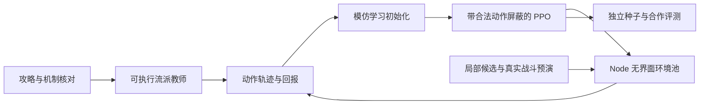

# 卫戍协议终极模拟 agent：调研与可执行路线

日期：2026-10-17。目标：目前使用开源复刻版，先打通单人终极模拟，再训练合作模式；最终同时考虑多流派、叠层与经济循环。本文区分源码事实、实际测量、视频线索与方案建议。

2026-10-18 补充：实际训练与数据分级约定见 [TRAINING-PLAN.md](TRAINING-PLAN.md)，包括混合盟约发动机、BC → PPO、混合水平队友池和跨策略配合评测。后续大批量 B 站采集独立记录在 `knowledge/corpus/`；下文第 2 节保留最初探索的范围，不代表后续总量。服务器原游戏页面回放的入口与验证见 [DEPLOYMENT.md](DEPLOYMENT.md)。

## 结论

推荐路线是 **复用开源真实模拟器 → 接结构化训练接口 → 流派脚本与现有机器人提供示范 → 带合法动作屏蔽的 PPO → 局部搜索增强站位与关键选择 → 合作训练**。

现有项目的价值超过一个可玩的网页：它已经有纯 JavaScript 确定性战斗、虚拟时钟、完整对局、规则机器人、站位候选预演、并行基准工具。无需从截图识别和鼠标控制起步，也无需先重写 Python 战斗模拟器。**目前尚无本任务训练出的模型，现有机器人在本次 32 局终极短测中没有胜局。**

不建议第一版直接复刻整个 MuZero 系统。先做小而可评测的学习闭环；当策略训练稳定、模拟与搜索接口可靠时，再判断 MuZero/长程树搜索的收益。以下为工程建议，不是已验证的算法优胜结论。

## 1. 源码核查：哪些已经有，哪些还要做

核查版本：`sganggs/Stronghold-Protocol`，版本号 `0.3.0`，固定提交 `6ab2468279e926d107788f63d7fe219b85f67b4a`。本地完整源码位于 `Stronghold-Protocol/`。初次核查与基线使用原始模拟规则，后续增加了原页面轨迹回放入口与界面，未修改战斗和经济规则。所有源码链接均固定到该提交。

| 能力 | 核查结果 | 对训练的意义 |
|---|---|---|
| 无界面完整对局 | `tools/matchrun.mjs`、`tools/botbench.mjs` 直接构建 Match，真实战斗，无需页面或素材 | 可批量采样 |
| 加速 | `VirtualScheduler` 跳过现实等待，战斗步进直到结束 | 可以快于客户端实时游戏；仍须计算每个战斗 tick |
| 确定性 | 固定种子，战斗固定 1/30 秒步长，战斗模块不依赖墙上时间 | 可复现失败、做动作序列重放与成对比较 |
| 单人/合作/终极 | `solo` / `coop`；终极代码为 `ABYSS` | 无需先开发目标关卡 |
| 原子动作 | `Match.handle(playerId,msg)` 接 `g.buy` / `g.refresh` / `g.levelUp` / `g.sell` / `g.move` / `g.equip` / `g.ready` 等 | 从现有验证通道接 agent，保持经济与部署规则 |
| 结构化观察 | `publicView()`、`PlayerState.privateView()`，含商店、棋盘、整备、资金、盟约等 | 可直接做特征编码 |
| 现成教师/基线 | `server/match/bot.js`：盟约选择、购卡、合成、角色补足、站位、道具、机变 | 可采合法轨迹；通关能力须另测 |
| 局部真实搜索 | 机器人布局候选用真实 Battle 预演，选漏怪少的布局 | 可复用局部规划，不必先训练战斗结果模型 |
| 批量基准 | `botbench --jobs` 使用 worker threads；当前工具最多 16 个 jobs | 先用已有工具测瓶颈；更大采样器另建进程池 |
| Gym/RL 接口 | 本次核查未发现现成标准化 RL 接口 | 需补 reset/step/observe/action_masks 与 rollout 收集 |
| 任意状态分叉恢复 | 见到了显示快照、BattleSpec 重建和联防 carryState，尚未确认通用完整 Match clone/restore 接口 | 不能把 `snapshot()` 当可逆的世界存档；初期用固定种子+动作日志重放 |

源码证据：[虚拟时钟](https://github.com/sganggs/Stronghold-Protocol/blob/6ab2468279e926d107788f63d7fe219b85f67b4a/server/match/scheduler.js)、[基准工具](https://github.com/sganggs/Stronghold-Protocol/blob/6ab2468279e926d107788f63d7fe219b85f67b4a/tools/botbench.mjs)、[整局工具](https://github.com/sganggs/Stronghold-Protocol/blob/6ab2468279e926d107788f63d7fe219b85f67b4a/tools/matchrun.mjs)、[动作路由](https://github.com/sganggs/Stronghold-Protocol/blob/6ab2468279e926d107788f63d7fe219b85f67b4a/server/match/match/intents.js)、[私有观察](https://github.com/sganggs/Stronghold-Protocol/blob/6ab2468279e926d107788f63d7fe219b85f67b4a/server/match/player/views.js)、[机器人](https://github.com/sganggs/Stronghold-Protocol/blob/6ab2468279e926d107788f63d7fe219b85f67b4a/server/match/bot.js)、[模拟接口](https://github.com/sganggs/Stronghold-Protocol/blob/6ab2468279e926d107788f63d7fe219b85f67b4a/docs/SIM.md)。

### 相比官方客户端

目前没有官方客户端可对照，以下是基于接口的判断：客户端实机更适合最终验证，开源版更适合训练。实机除了加速有限，还缺少可控的并行 reset、精确状态读取、任意局面重放、局部分支评测。截图识别/OCR、拖拽定位、界面等待还会额外引入错误。

在复刻版通关只能证明复刻版能力。仓库自己说明部分行为按推断实现，`[ASSUMED]` 在战斗与盟约代码中仍存在；其历史平衡修正涉及 Boss 血池、伤害叠加、波次生成，足以改变策略强弱。训练时固定代码与数据，升级后重新跑基准；若以后能访问官方客户端，抽样核对核心叠层、经济闭环和 Boss 伤害，不能直接声称已迁移成功。[架构](https://github.com/sganggs/Stronghold-Protocol/blob/6ab2468279e926d107788f63d7fe219b85f67b4a/docs/ARCHITECTURE.md)、[平衡核对记录](https://github.com/sganggs/Stronghold-Protocol/blob/6ab2468279e926d107788f63d7fe219b85f67b4a/docs/BALANCE.md)。

## 2. B 站找到的路线及使用方式

直接用 B 站搜索 `卫戍协议 终极模拟`，获得 20 个视频条目；再搜索 `卫戍协议 叠层 盟约` 时浏览器导航被拒绝，停止重试，补用了公开网页索引中的 B 站原视频页。**没有完整观看下列视频，也没有取得可逐步对齐的全套字幕/操作标注。标题里的“每把”“无脑”“高胜率”只是作者主张，未验证。**

| 路线 | 原视频与作者 | 对 agent 的训练价值（推断） |
|---|---|---|
| 二本叙拉古 | [《叙拉古二本流：最稳终极打法保姆级教学》](https://www.bilibili.com/video/BV1YTX5BbEGW)，柠檬味の小小猪 | 商店等级受限，可先缩小购卡与运营空间，适合首个流派候选 |
| 谢拉格叠层 | [《超简单终极模拟「谢拉格」教学！每把都能999层！》](https://www.bilibili.com/video/BV1xVdBBWEuu)，Cold凉TAT | 学习叠层发动机、前中期存活与最终输出切换 |
| 维多利亚 | [《宝宝级终极模拟「维多利亚」超高胜率教学！》](https://www.bilibili.com/video/BV1nyDKB5Eoj)，Cold凉TAT | 装备收益、层数里程碑与配装联动 |
| 变形者维多利亚 | [《变形者维多利亚实战拆解》](https://www.bilibili.com/video/BV1gdDwBnEU4)，重生之冰 | 策略、转职与输出载体的组合 |
| 一本/夕分队焚诀 | [《无视ban位！顶级焚决！补丁后/一本流/夕分队/终极模拟保姆级教程》](https://www.bilibili.com/video/BV1M5Q7BtEYE)，深糖幻梦QAQ；2026-04-15 | 另一条低本运营候选；需确认补丁和复刻实现一致 |
| 罗素 | [《终极模拟罗素攻略：叫我罗奶奶，保证boss门前带》](https://www.bilibili.com/video/BV1Yk9jBTEgP)，星梦黄昏月 | 作为不同策略机制的对照，避免只学一种开局 |
| 盟约基础 | [《看懂八个核心盟约叠层方式》](https://www.bilibili.com/video/BV1a9wbzdE2S)，白樱iridescent；2026-03-15 | 建立机制索引；不能直接当下游动作数据 |
| 倒转机制 | [《两套电表倒装打法：150远见/70投资人奇迹》](https://www.bilibili.com/video/BV1rBwhzyE6V)，白樱iridescent；2026-03-15 | 经济闭环线索；视频时间早于终极开放/后续补丁，不照抄阈值 |
| 二期倒转 | [《卫戍2期依然能电表倒转的方法》](https://www.bilibili.com/video/BV1m2wuzfEMA)，-录音机-；2026-03-15 | 与后续补丁对照，拆分取得收益、复制特质、层数变现链条 |

日期与简介仅在公开索引能确认的条目中列出。其他条目链接与标题来自当次 B 站搜索结果，搜索输出保存在 `bilibili-search.json`。

建议先选 **二本叙 + 谢拉格** 做两种不同运营风格的可执行教师，维多利亚和经济倒转作为第二批。选择依据是缩小初期搜索空间并覆盖不同机制，不代表这两套已被验证为当前最强。每个教师必须含：启动条件、禁用盟约下的回退、关键牌未到时的替代、何时停止叠层补战力、Boss 前转型、合法动作与终止条件。

### 叠层为什么必须单独建模

仓库当前规则中有 23 个盟约；核心包括炎、萨尔贡、维多利亚、谢拉格、拉特兰、阿戈尔、叙拉古、卡西米尔。层数与激活人数是不同变量。远见、奇迹、投资人的激活会计入整备区；大多数其他盟约依赖场上成员。源码还区分获得时、主动刷新时、进入/结束休整期、战斗中等触发事件。

所以 agent 需要知道的不只是“还缺几个同阵营”，还包括：

- 谁提供持续层数，谁提供一次性层数，谁能复制/放大特质；
- 哪个盟约未激活但已经存有层数，哪些里程碑已经付过收益；
- 购入、卖出、刷新、复制、装备/转职的先后顺序是否形成正收益链；
- 继续练功会不会导致本回合漏怪、花光资源或错过准备时限；
- 何时层数够用，应把经济转成能守住和打 Boss 的阵容。

收益循环应做成可以执行若干次、检查净收益并自动停止的宏动作，实际收益以当前引擎为准；预算应能容纳倒转流的大量合法动作，不能照抄内置机器人的最多 16 次刷新限制作为玩法规则。

**经济与 TFT 的关键差异：通常剩余资金在休整结束时清空；特定策略例外。** 因此不能直接照搬 TFT 存钱吃利息的价值函数。规则证据：[回合结算](https://github.com/sganggs/Stronghold-Protocol/blob/6ab2468279e926d107788f63d7fe219b85f67b4a/server/match/player/round.js#L38)、[盟约计数](https://github.com/sganggs/Stronghold-Protocol/blob/6ab2468279e926d107788f63d7fe219b85f67b4a/server/match/bondsMeta.js)、[盟约研究与来源](https://github.com/sganggs/Stronghold-Protocol/blob/6ab2468279e926d107788f63d7fe219b85f67b4a/docs/research/02-bonds.md)、[特质识别](https://github.com/sganggs/Stronghold-Protocol/blob/6ab2468279e926d107788f63d7fe219b85f67b4a/server/match/bot.js#L480)。早期研究文档中有旧假设，冲突时以固定版本运行代码和当前配置为准。

## 3. 建议的训练系统

### 自走棋技术方案核实

独立源码调研详见 [TFT 对照笔记](tft-reference-research.md)。最相关的几个结果是：

- [TFTMuZeroAgent](https://github.com/silverlight6/TFTMuZeroAgent) 当前主分支已转为 Set 4 模拟器；历史提交有真实 MuZero/PyTorch/Ray/MCTS 训练代码，但作者两周年报告承认规划方法尚未取得有意义结果。适合参考结构化观察、合法动作、站位/装备子任务，不能当现成强玩家。
- [Riot GDC 2023：Simulating Teamfight Tactics](https://www.gdcvault.com/play/1028851/Machine-Learning-Simulating-Teamfight) 的原始材料支持商店决策和部署决策分工、逐步增加复杂度、学习式战斗结算分布的思路；没有本任务可直接复用的开放模型。
- [super-ml-pets](https://github.com/andreped/super-ml-pets) 提供更完整的模拟器、MaskablePPO 训练和公开权重闭环，游戏不同且规则较旧，工程参考价值高于直接迁移模型。
- [AlphaTFT](https://github.com/utilForever/AlphaTFT) 本次核查到的实际代码只是加法函数和测试，不能当 TFT 强化学习实现。金铲铲视觉自动拿牌项目也应与长期构筑策略学习区分。



### 环境与进程边界

保留 JS 的 Match、PlayerState、Battle 作为唯一规则实现；补一个 `reset(seed, mode, difficulty)`、`observe(player)`、`legal_actions(player)`、`step(action)` 包装。Python 负责 PyTorch 学习，Node worker 负责模拟，使用持续进程与批量消息传输，避免每一步重新启动 Node。第一版可用本地管道/Unix socket，先测通信与编码耗时再优化。

`step` 只在有决策的阶段返回；战斗直接快进到下一个决策点，保留逐 tick 真实计算。合作时处理当前可行动座位，`ready` 是每个座位独立的动作，全部就绪后再进入战斗，不能让一个 agent 的 step 跳过另一个的采购阶段。多人准备时限要保留独立的评测配置。

记录每一步的合法输入、返回、观察、动作 mask、奖励与终止原因，并把代码 SHA、数据身份、配置、种子、教师/策略版本写进轨迹元数据。先验证同种子同动作序列得到同样结果。完整存档暂用 replay，若后续长程搜索需要，再实现包含 RNG、商店、池、特质计数、奖励状态和调度器状态的显式 checkpoint。

### 观察与动作

观察使用当前玩家可见信息白名单，包含阶段/回合、资金与免费刷新、商店等级和报价、棋盘格/朝向/地形、干员及装备、整备区、盟约成员数/层数/里程碑、策略、公开禁用、公开敌人预览。合作增加公开队友阵容、LP、盟约和 Boss 搭档。

不把隐藏 RNG、未来商店序列、未来随机事件、仅内部可见的其他玩家状态传入策略。内置机器人用到共享池剩余量，若未来迁移官方游戏，应确认该信息是否确实可见，否则改成基于公开购买记录的估计。精确战斗种子可用于回归复现，但搜索和评测另设“多个独立随机样本”模式，避免只会利用一次已知随机结果。

用实体集合编码（先小 MLP/池化，需求明确再加 Transformer），不要把截图作为首版输入。输出分为动作类型和条件参数：购买哪个槽位、卖哪个 uid、把哪个单位放哪个格子/朝向、装备给谁、选哪张机变、刷新/升级/准备。每层参数都根据前面的选择生成合法 mask；简单独立的 MultiDiscrete mask 不一定能表达所有参数相关性。

初期学习“买/刷/升/保留何种角色/何时转型”，部署先交给现成规划器，随后让策略在候选布局中选择，再逐步开放自由站位。这样第一阶段学习的是运营，后续逐步扩大控制范围；需要在实验标签中写清 agent 实际控制了哪些决策。

### 算法选择

首版采用流派教师和规则 bot 的轨迹做行为克隆初始化，然后用带合法动作屏蔽的 PPO 优化实际通关奖励。规则 bot 的示范提供合法性与基本运营；它在本次目标难度没有胜局，不能把它的动作统一当“专家正确答案”。加入成功的流派教师、人工纠正和搜索改善轨迹后再混合训练。

可先用 SB3-Contrib `MaskablePPO` 验证环境和离散候选动作；若需要条件参数、自回归动作或循环记忆，需自定义策略/训练器。该库当前明确不支持 recurrent policy，不能把 RecurrentPPO 与 MaskablePPO 当作现成可叠加功能。[库文档](https://sb3-contrib.readthedocs.io/en/master/modules/ppo_mask.html)、[非法动作屏蔽论文](https://arxiv.org/abs/2006.14171)、[PPO 原论文](https://arxiv.org/abs/1707.06347)。

有真实模拟器时，站位/装备分配/机变等有限候选可先用真实短程搜索；购卡后未来商店未知，要采样未来而不是读取真实未来序列。MuZero 的价值是学习紧凑的预测和规划表示，不是有模拟器就完全无用，但首版同时做环境、表示学习、价值、策略和树搜索，诊断成本更高。

### 课程与奖励

先练购卡/装备/叠层等小场景，再练全局。全局课程优先险境 → 绝境 → 终极；标准模式禁用了部分盟约，不能指望只在标准训练就学全全部目标机制。首批只开放两种可执行流派，稳定后加入更多策略、禁用和转型分支。

主要奖励是实际通关、存活与击败目标 Boss；第 14 回合通关、第 15 回合隐秘核心触发、第 15 回合击败必须分别记录。少量中间反馈可以辅助训练，但不要用“层数总和越高越好”“Boss 伤害越高越好”代替胜利。否则会产生无意义叠层、刷循环拖延、合作中抢输出却不兜底等行为。中间反馈优先使用有界的里程碑和状态势函数，正确处理宏动作时长、截断与真正终止。

合作阶段先训练 1 个学习座位搭配固定脚本队友，再改变队友强弱/流派，最终训练共享参数的多座位策略。需要协调共用卡池、分流派、联防和 Boss 搭档；目标是团队通关。可以研究集中 critic、分散执行（MAPPO 等），但不是第一阶段的前置工作。

## 4. 服务器与实测基线

2026-10-17 经 SSH 现场核查 `smYuHangLab3`：

| 项目 | 结果 |
|---|---|
| CPU | 128 逻辑核 |
| 内存 | 503 GiB；当时 available 约 484 GiB |
| GPU | 4 × NVIDIA RTX A6000，每卡 49140 MiB；已有其他任务占用，不能按全部空闲估算 |
| 主机 Node | v22.23.2，能够直接运行仓库工具 |
| Docker | 24.0.7 |
| 存储剩余 | 根分区约 256G；`/data1` 446G；`/data2` 1.8T；`/data3` 1.4T；`/data2`、`/data3` 当前用户可写 |
| Python 主机环境 | 当前解释器未发现 torch/gymnasium/ray；不代表其他 venv 或镜像没有 |
| GPU 容器实测 | `docker run --rm --pull=never --network none --read-only --gpus device=3 ubuntu:20.04 nvidia-smi -L` 失败：`could not select device driver ... capabilities: [[gpu]]` |

短测使用主机 Node，没有安装包或下载游戏素材。GPU 容器支持尚未配置成功；CPU rollout 不受影响。后续可在专用 Python 环境训练，或配置 NVIDIA Container Toolkit 后再验证 GPU 容器。本次没有修改 Docker daemon、驱动和已有服务。

按用户后续要求，远端文件已迁入 `/data1/zsm/arknights/`，代码在 `game/`；`/home/tzb/zsm` 是 `/data1/zsm` 的软链接，所以 `/home/tzb/zsm/arknights/` 指向同一位置。基准、研究文档、工具、服务日志和后续轨迹均放在该项目目录内。

### 32 局实际测量

每种配置 seeds 1–8，4 worker；全量战斗内容、未加 LP 或层数。数字是带当前规则机器人的对局，不是学习 agent 的训练步吞吐。

| 模式 | 每次准备的站位候选预演上限 | 局数 | 平均每局墙上耗时 | 平均已通过回合数 | 胜局 | 引擎记录错误 |
|---|---:|---:|---:|---:|---:|---:|
| 单人终极 | 0 | 8 | 2.24 s | 11.75 | 0/8 | 0 |
| 四人合作终极 | 0 | 8 | 5.75 s | 11.00 | 0/8 | 0 |
| 单人终极 | 3 | 8 | 5.49 s | 12.25 | 0/8 | 0 |
| 四人合作终极 | 3 | 8 | 19.84 s | 11.62 | 0/8 | 0 |

全部未触发隐秘核心。部分局提前失败，不能把这些耗时当作稳定打满 15 回合的成本；4 worker 会影响单局耗时，也没有测满 128 核扩展能力。8 个种子只用于冒烟与定位训练起点，不是可靠胜率估计。预演在这组样本上增加耗时并略增平均通过回合，没有观察到胜率提升。

复现：

```bash
node tools/botbench.mjs --configs solo:ABYSS,coop4:ABYSS \
  --seeds 8 --jobs 4 --rehearsal 0 --quiet --json ../benchmark-r0.json
node tools/botbench.mjs --configs solo:ABYSS,coop4:ABYSS \
  --seeds 8 --jobs 4 --rehearsal 3 --quiet --json ../benchmark-r3.json
```

本地原始结果：`benchmark-r0.json`、`benchmark-r3.json`；另有本地单局 `local-smoke.json`，它不计入上述远程统计。

初期资源建议：先 16–32 个 CPU rollout worker 和 1 张当时空闲的 A6000，保留其他任务资源；先测带真实 learner 的环境 steps/s、通信耗时、推理等待与 GPU 利用率，再加并行。小型策略不保证 GPU 比 CPU 快；4 卡不是首版必要条件。当前证据不能给出“训练几小时必通关”的承诺。

## 5. 开工顺序与验收

1. **环境闭环**：固定版本；能 reset/step；所有动作经原有规则校验；观察不泄露未来；同种子动作日志可重放；能跑完单人和合作并识别终止原因。
2. **教师闭环**：把二本叙、谢拉格的具体操作核对并实现，先在训练种子形成成功局；内置 bot 作为弱基线。B 站标题和视频文本本身不作为强化学习轨迹。
3. **学习闭环**：行为克隆初始化 → Masked PPO；先学习运营，站位复用规划器；对照脚本、纯规则 bot、无预演和有预演。
4. **泛化闭环**：固定独立评测集，覆盖地图/敌人类型/Boss/禁用/开局策略；种子不能在训练或挑 checkpoint 时泄漏。先 100 局看趋势，再以 500–1000 局和置信区间报告稳定胜率（数量为建议）。
5. **合作闭环**：固定队友 → 混合水平/不同流派队友 → 多学习座位；单列 1 个学习 agent 配 3 个固定 bot 与 4 个学习 agent 的成绩，不能互相混报。
6. **演示闭环**：保存动作轨迹，让浏览器按原节奏重放；抽样运行真实界面，以确认训练包装器和实际玩法一致。

第一个演示目标建议定义为：**一个能在开源版、固定版本、未见种子上自主运营并通关单人终极的 agent，附回放与失败分解**。先取得成功轨迹，再追求稳定胜率与多流派。若要求第 15 回合通关，应从一开始另列严格指标。

失败分解至少区分：前期漏怪淘汰、叠层发动机未启动、经济循环无净收益、对空/阻挡缺失、Boss 超时、非法动作、包装器截断、引擎错误。合作增加卡池冲突和联防失败。模型选择以真实目标通过率为准。

## 6. 搜索覆盖与局限

- B 站 OpenCLI：`卫戍协议 终极模拟` 1 次成功，20 条；`卫戍协议 叠层 盟约` 1 次失败（Navigation rejected）。合计 2 次，达到该技能默认上限，停止重试。
- 网页搜索补充：TFT 强化学习/自走棋技术方案、B 站终极/叠层/具体流派等查询；保留原项目和原视频作为引文，不把二手聚合页当机制证据。
- GitHub：直接读取用户指定仓库，固定提交克隆并检查实际代码；TFT 对照单独见 `tft-reference-research.md`。
- 技术依据使用项目原始代码、算法论文和库官方文档。B 站视频本轮覆盖到检索、标题和部分简介，尚未完成全片机制标注。
- 调研阶段完成资源核查和短基准，未实现 RL wrapper、未训练模型、未声称终极通关。后续用户要求的轨迹导出与前端预览见下一节。

## 7. 后续执行：轨迹与预览

按用户要求导出 32 局规则 bot 数据：单人险境、单人绝境、单人终极、四人合作终极各 seeds 1–8，共 11,556 步方法级操作记录。险境 4/8、绝境 3/8、两种终极均 0/8；引擎和调度器错误均为 0。动作中有 8 次被原规则拒绝，记录 `accepted:false`，模仿学习需过滤。

每步含当前座位的公开/私有观察、等价 g.* 动作、即时结果和后状态，保留最终胜负标签。数据采自上游规则机器人调用的 PlayerState 校验方法和选牌应用边界；不是已经完成的标准 RL 环境。普通步骤的 next_observation 是方法调用后的即时状态；战斗间隔不会被误称为已完成的 RL step。每座位最后一次操作标注终局结果，额外终局记录保留完整 summary；合法动作 mask 尚未导出。适合先做行为克隆与失败分析，后续还需标准化学习接口。

`trajectories/*.jsonl.gz` 为压缩原始数据；`trajectories/manifest.json` 为索引。单人终极 seed 1 的 14 场实际战斗还保存了 1/30 s 模拟、每 3 tick 取帧的事件和快照，供上游战斗渲染器回放。录制器不代替 bot 决策，不加入 LP/层数。

预览端口 `38181`，轨迹页 `/dev/agent/`，原游戏 `/`。页面支持选对局、座位、回合、逐步/自动播放、进度条、棋盘/商店/整备区/盟约变化、原始轨迹下载及实际战斗录像。复用原渲染器的战斗录像支持暂停、倍速、拖动时间。

按用户进一步要求，已在原游戏入口增加 `/?replay=solo-ABYSS-s1` 模式：直接复用原 GameScreen、商店、盟约、棋盘和战斗渲染器；首页右上角新增入口。原界面回放不连接游戏 WebSocket，不发送操作，底部独立控制条提供播放/暂停、0.5–8 倍速、回合和操作跳转、合作座位切换；准备动作后可衔接已录制战斗。原始数据额外保留完整 publicView 以匹配原界面合同。部署与启动说明见 [DEPLOYMENT.md](DEPLOYMENT.md)。

新增工具源码保存在本地 `preview-tools/`，页面在 `preview-web/`，远端分别部署到 `tools/` 和 `game/public/dev/agent/`。服务为主机 Node 后台进程，没有修改系统驱动或已有 Docker 服务。
